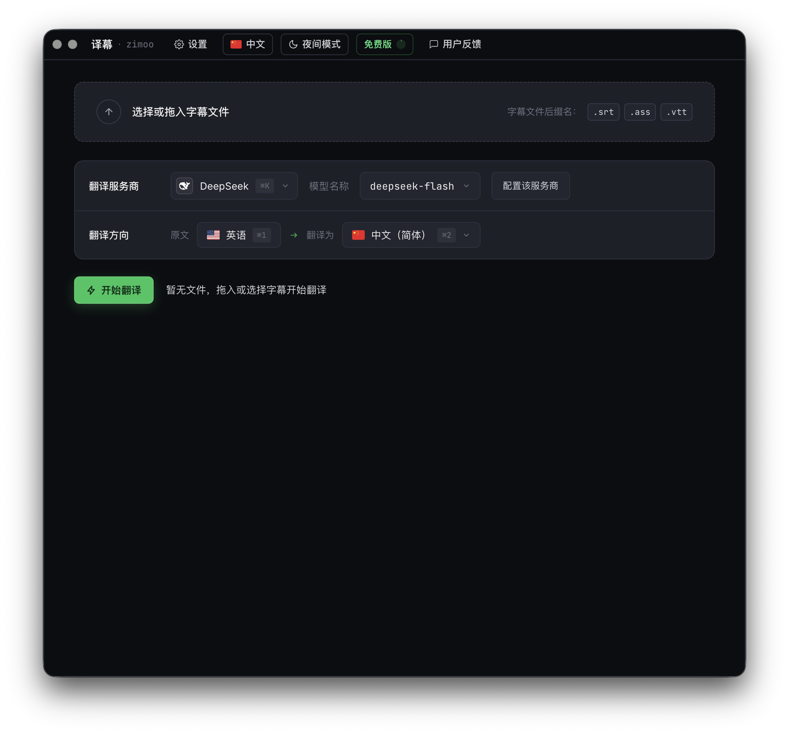
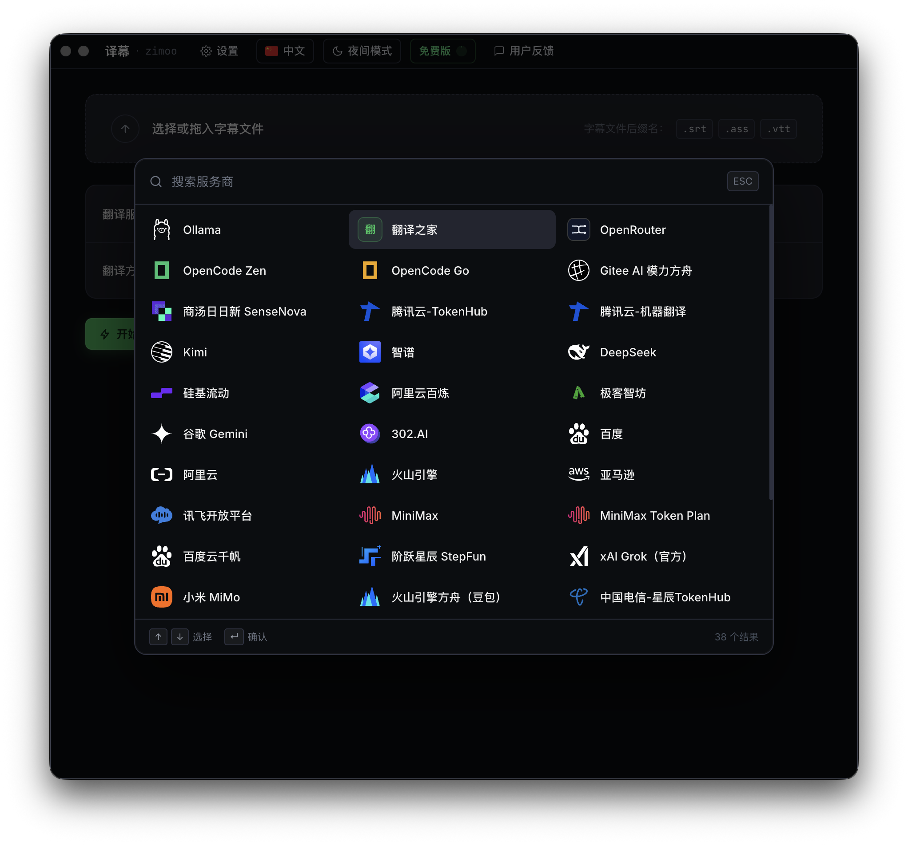
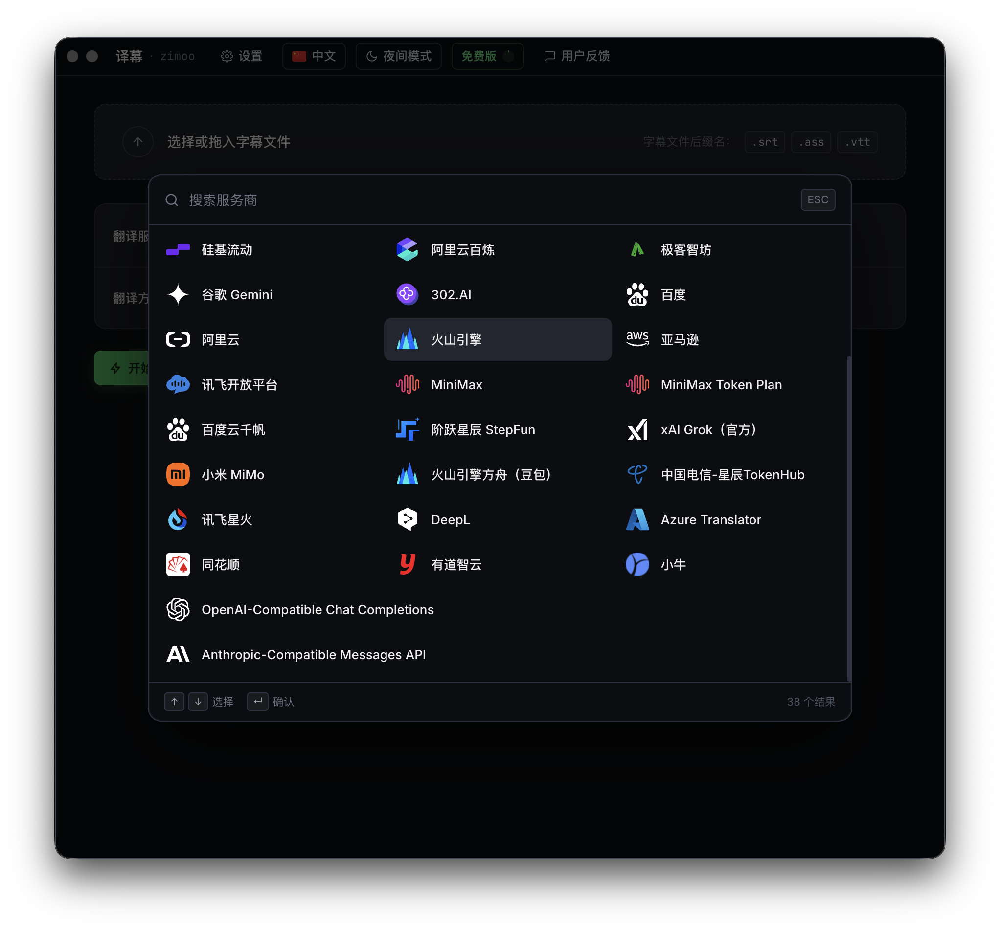
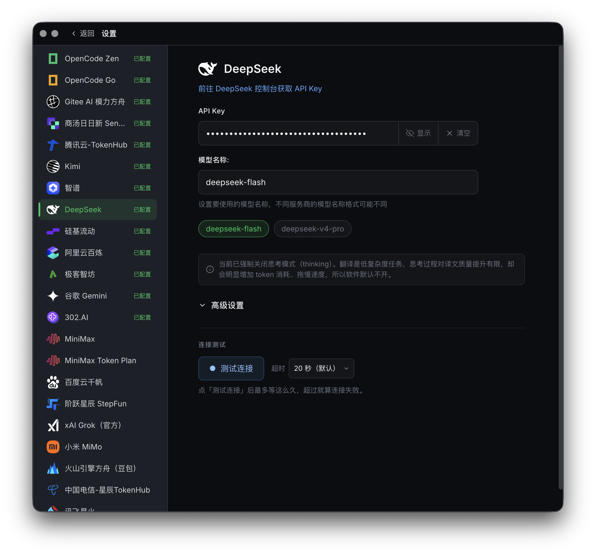
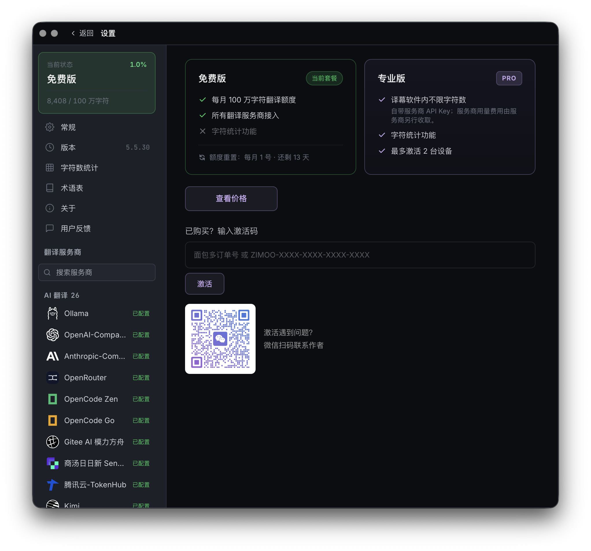
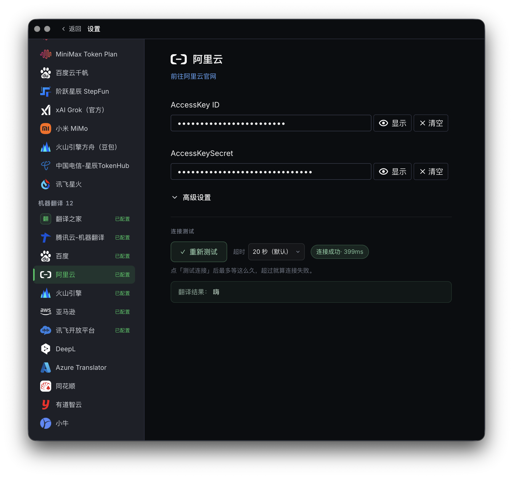

# 译幕 Zimoo

把英文（或日文、韩文等）字幕文件一键翻译成中文，支持 .srt / .ass / .vtt，可接入 DeepSeek、Kimi、DeepL 等 38 家翻译服务商。

**[打开网页版](https://zimoo.app)** · **[下载桌面版](https://zimoo.app/#/download)** · [使用教程](https://doc.tern.1c7.me/zh/)

## 开始使用

| 网页版（推荐） | 桌面版 |
| --- | --- |
| **[zimoo.app](https://zimoo.app)** | **[下载安装包](https://zimoo.app/#/download)** |
| 打开即用，不用安装；需要翻墙 | 下载安装后使用 |

第一次使用需要先到翻译服务商那里注册、拿到 API Key，填进软件就能用。不会弄就看[使用教程](https://doc.tern.1c7.me/zh/)。

## 能帮你做什么

- **翻译字幕文件**：拖入 .srt / .ass / .vtt，输出中英双语字幕或纯译文
- **38 家服务商任选**：26 家 AI 大模型（DeepSeek、Kimi、智谱、Gemini、Ollama 本地模型等）+ 12 家机器翻译（DeepL、百度、腾讯、阿里云、火山等）
- **最省钱**：你直接给服务商付费，没有中间商加价，还能用上服务商的免费额度
- **多语言**：英、日、韩、德、法、俄、西、意等，服务商支持的语言都能翻

适合想看懂外语视频的个人，也适合先机翻出初稿、再人工校对的字幕组。

## 免费版和专业版

| | 免费版 | 专业版 |
| --- | --- | --- |
| 每月翻译字数 | 100 万字符（每月 1 号重置） | 不限 |
| 全部翻译服务商 | 支持 | 支持 |
| 字符统计 | 无 | 有 |

服务商的费用由服务商另外收取，与你用免费版还是专业版无关。[各服务商的免费额度和价格](https://doc.tern.1c7.me/zh/folder/pricing/)

## 媒体报道

- [少数派：让「熟肉」来得更快一点，省时省力制作双语字幕](https://sspai.com/post/59168)（2020 年）
- [小众软件：字幕组机翻小助手，自动翻译英文字幕为中英双语字幕](https://www.appinn.com/tern-subtitle-file-translator/)（2020 年）

<b>联系作者</b>

- QQ：1003211008
- 邮箱：zhengcheng.dev@gmail.com

<b>用户 QQ 群</b>

- 四群：489975465（38/200）
- 三群：128986462（195/200）
- 二群：658774053（488/500）
- 一群：982808006（492/500）

<b>同类软件</b>

- [妙幕 SmartSub](https://github.com/buxuku/SmartSub)：批量为音视频生成字幕并翻译
- [字幕酱](https://www.zimujiang.com/)
- [VideoSrt Pro](https://www.yuque.com/viggo-t7cdi/videosrt-pro/cpwtwl)
- [LLM-Subtrans](https://github.com/machinewrapped/llm-subtrans)
- [Subtitle Translator](https://github.com/gnehs/subtitle-translator-electron)

---

本软件原名「字幕组机翻小助手」（英文名 Tern）。改版前的旧 README（含详细的同类产品对比、旧版功能说明）存档在 [app/doc/old-readme-2026-10-18.md](app/doc/old-readme-2026-10-18.md)。
